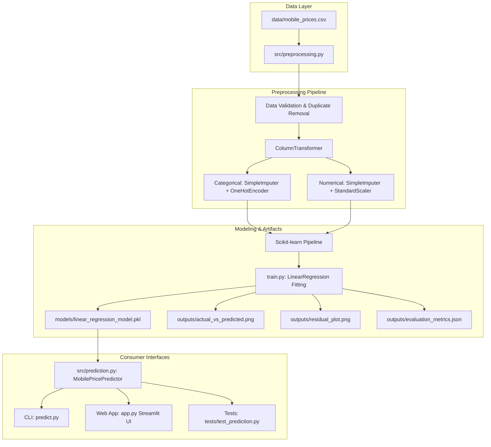
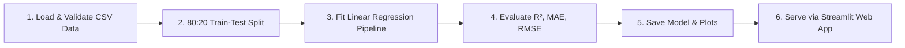

# 📱 Mobile Price Estimation Using Machine Learning

A complete, production-ready, beginner-friendly Machine Learning project built with Python, Scikit-learn, and Streamlit to estimate smartphone prices in Indian Rupees (₹) based on technical hardware specifications.

---

## 1. Project Title
**Mobile Price Estimation Using Machine Learning (Linear Regression)**

---

## 2. Abstract
The smartphone marketplace is characterized by a rapid influx of diverse devices spanning varying hardware capabilities and pricing brackets. Prospective buyers, retailers, and market analysts frequently need an objective, data-driven methodology to assess whether a smartphone's retail price aligns with its underlying hardware specifications. This project presents an end-to-end Machine Learning pipeline utilizing **Multiple Linear Regression** to model and predict smartphone prices in Indian Rupees (₹). Trained on real-world market data across multiple leading brands, the system integrates data preprocessing, categorical encoding, feature scaling, model training, persistence, an interactive Streamlit web application, and automated unit testing.

---

## 3. Problem Statement
Determining fair market valuations for smartphones is complex due to the multitude of interrelated technical specifications, such as RAM, internal storage, camera megapixels, battery capacity, processor architecture, and network generations (4G vs. 5G). Traditional rule-of-thumb pricing often suffers from subjective brand markups or pricing opacity. There is a need for a transparent, reproducible, and explainable computational regression system that can quantify the relationship between hardware specifications and market prices in Indian Rupees.

---

## 4. Objectives
- **Data Ingestion & Cleaning:** Ingest real-world smartphone specifications, validate numerical ranges, sanitize categorical features, and remove duplicates without data leakage.
- **Pipeline Architecture:** Construct a reusable Scikit-learn preprocessing and modeling pipeline utilizing `ColumnTransformer`, `StandardScaler`, `OneHotEncoder`, and `SimpleImputer`.
- **Model Training:** Train a Multiple Linear Regression model on 80% of the dataset with reproducible random seeding (`random_state=42`).
- **Empirical Evaluation:** Rigorously evaluate the model on an independent 20% hold-out test set using R² Score, Mean Absolute Error (MAE), Mean Squared Error (MSE), and Root Mean Squared Error (RMSE).
- **Model Persistence:** Save the fitted pipeline using Joblib for low-latency inference.
- **Interactive Web Interface:** Deliver an intuitive, responsive Streamlit web application enabling users to input custom specifications or select preset models and receive price estimates.
- **Automated Testing:** Implement unit tests with Pytest to verify model loading, input validation, and inference consistency.

---

## 5. Scope
- **Included:**
  - Smartphones launched and priced in the Indian market (prices in ₹).
  - Specifications: Brand, RAM, Internal Storage, Battery Capacity, Screen Size, Rear Camera MP, Front Camera MP, Processor Brand, 5G Support.
  - Interactive prediction via CLI (`predict.py`) and Web UI (`app.py`).
  - Generation of actual-vs-predicted scatter plots and residual plots.
- **Excluded:**
  - Used/refurbished physical cosmetic condition (scratches, dents).
  - Dynamic daily discounts, localized tax variations, and bank credit card promotions.

---

## 6. Existing System vs. Proposed System

| Dimension | Existing System / Manual Heuristics | Proposed Machine Learning System |
|---|---|---|
| **Approach** | Manual comparison tables or subjective brand intuition | Quantitative Supervised Regression modeling |
| **Consistency** | Highly subjective and inconsistent across price tiers | Deterministic, mathematical feature weighting |
| **Speed** | Slow manual lookup across multiple e-commerce websites | Instant price estimation (< 50ms) |
| **Interpretability** | Opaque or biased toward marketing claims | Clear regression coefficients and metric reporting |
| **Interface** | Fragmented spreadsheets or forum advice | Streamlined, interactive Streamlit graphical interface |

---

## 7. Functional Requirements
1. **Data Ingestion:** Load CSV data containing hardware specifications and target price in INR.
2. **Data Validation:** Check for mandatory columns, reject negative values, and drop duplicate records.
3. **Preprocessing Pipeline:** Impute missing values, one-hot encode categorical features, and scale numerical attributes.
4. **Model Training:** Fit a Scikit-learn Linear Regression model using an 80:20 train-test split.
5. **Artifact Generation:** Save the trained pipeline (`.pkl`), evaluation metrics (`.json`), and evaluation plots (`.png`).
6. **Command-Line Prediction:** Accept specification inputs via CLI arguments or default parameters and output formatted ₹ price.
7. **Web UI:** Provide slider and select-box controls, input validation, quick-fill device presets, and metric dashboards in Streamlit.
8. **Automated Testing:** Run pytest test suites covering model loading, inference validity, and error handling.

---

## 8. Non-Functional Requirements
- **Accuracy & Transparency:** Accurately report R², MAE, MSE, and RMSE without fabrication.
- **Reliability:** Gracefully handle missing model files, unseen brand inputs, or invalid numerical ranges.
- **Portability:** Path-agnostic file management using Python's `pathlib.Path`, runnable across Windows, macOS, and Linux.
- **Usability:** Responsive UI with clear metric explanations and Indian currency grouping (e.g., ₹38,999).
- **Maintainability:** Modular separation of concerns into `src/preprocessing.py`, `src/prediction.py`, `train.py`, and `app.py`.

---

## 9. Hardware and Software Requirements

### Hardware Requirements
- **Processor:** Intel Core i3 / AMD Ryzen 3 or higher (Dual-Core or Quad-Core CPU).
- **RAM:** Minimum 4 GB (8 GB recommended).
- **Storage:** At least 500 MB free hard drive space.

### Software Requirements
- **Operating System:** Windows 10/11, macOS, or Linux.
- **Runtime Environment:** Python 3.9 through Python 3.14.
- **Key Libraries:** Pandas, NumPy, Scikit-learn, Matplotlib, Seaborn, Streamlit, Joblib, Pytest.

---

## 10. Dataset Description
- **Dataset File:** `data/mobile_prices.csv`
- **Origin & Source:** Indian Smartphone Market Specifications & Price Dataset (Smartprix / 91mobiles open community dataset).
- **License:** Open Access / Educational and Research Use.
- **Total Records:** 980 smartphone configurations.
- **Cleaned Training Records:** 972 valid unique records after duplicate removal.
- **Target Variable:** `price` (Retail price in Indian Rupees, ₹).
  - **Minimum Price:** ₹3,499.00
  - **Median Price:** ₹19,999.00
  - **Mean Price:** ₹32,633.36
  - **Maximum Price:** ₹650,000.00 (Luxury Vertu Signature)

---

## 11. Feature Descriptions

| Feature Name | Column in CSV | Data Type | Units / Range | Description |
|---|---|---|---|---|
| **Brand** | `brand_name` | Categorical (String) | Apple, Samsung, Xiaomi, OnePlus, Realme, etc. | Smartphone manufacturer brand. |
| **RAM** | `ram_capacity` | Numerical (Float) | 1 GB to 24 GB | Operational system memory capacity. |
| **Internal Storage** | `internal_memory` | Numerical (Float) | 8 GB to 1024 GB | Flash storage (ROM) for apps and files. |
| **Battery Capacity** | `battery_capacity` | Numerical (Float) | 1,500 to 7,000 mAh | Battery capacity in milliampere-hours. |
| **Screen Size** | `screen_size` | Numerical (Float) | 3.5 to 8.5 Inches | Diagonal display dimension. |
| **Rear Camera** | `primary_camera_rear` | Numerical (Float) | 5 to 200 Megapixels (MP) | Main rear camera sensor resolution. |
| **Front Camera** | `primary_camera_front` | Numerical (Float) | 2 to 64 Megapixels (MP) | Front-facing selfie camera resolution. |
| **Processor Brand** | `processor_brand` | Categorical (String) | Snapdragon, Bionic, Dimensity, Helio, Exynos, Unisoc | Chipset architecture family. |
| **5G Support** | `has_5g` | Binary (0 or 1) | 0 (No) / 1 (Yes) | 5G cellular network connectivity. |
| **Price (Target)** | `price` | Numerical (Float) | ₹3,499 to ₹650,000 | Market retail price in Indian Rupees. |

---

## 12. Algorithm Explanation: Multiple Linear Regression

Multiple Linear Regression is a supervised learning algorithm used to model the linear relationship between a continuous scalar dependent variable (target $y$) and one or more independent explanatory variables (features $x_1, x_2, \dots, x_p$).

### Core Concepts:
1. **Linear Combination:** The model assumes the target price is a weighted sum of the input specifications plus an intercept term.
2. **Ordinary Least Squares (OLS):** The regression coefficients are estimated by minimizing the **Residual Sum of Squares (RSS)**:
   $$\text{RSS} = \sum_{i=1}^{n} (y_i - \hat{y}_i)^2$$
3. **One-Hot Encoding for Categories:** Non-numeric categories (e.g. Brand and Processor) are transformed into binary indicator vectors ($0$ or $1$), allowing the model to estimate distinct baseline price premiums for each manufacturer (e.g., Apple vs. Xiaomi).
4. **Standardization:** Numerical features are scaled to zero mean and unit variance ($\mu=0, \sigma=1$) to stabilize matrix inversion during OLS fitting.

---

## 13. Linear Regression Mathematical Formula

The general mathematical formulation of Multiple Linear Regression is:

$$y = \beta_0 + \beta_1 x_1 + \beta_2 x_2 + \beta_3 x_3 + \dots + \beta_p x_p + \epsilon$$

Where:
- $y$ is the predicted mobile phone price in Indian Rupees (₹).
- $\beta_0$ is the $y$-intercept (the base price when all normalized features are zero).
- $\beta_1, \beta_2, \dots, \beta_p$ are the regression coefficients (weights) corresponding to specifications such as RAM, Storage, Battery, Camera MP, etc.
- $x_1, x_2, \dots, x_p$ are the standardized numerical values and one-hot encoded categorical indicator variables.
- $\epsilon$ is the residual error term ($\epsilon \sim \mathcal{N}(0, \sigma^2)$).

In matrix notation:

$$\hat{\mathbf{y}} = \mathbf{X} \boldsymbol{\beta}$$

Where the optimal parameter vector $\boldsymbol{\beta}$ is derived analytically via the normal equation:

$$\boldsymbol{\beta} = (\mathbf{X}^T \mathbf{X})^{-1} \mathbf{X}^T \mathbf{y}$$

---

## 14. System Architecture



---

## 15. Project Workflow



---

## 16. Project Folder Structure

```
mobile-price-estimation/
│
├── data/
│   └── mobile_prices.csv           # Smartphone specifications & prices dataset (980 rows)
│
├── models/
│   └── linear_regression_model.pkl # Fitted Scikit-learn Pipeline (Joblib format)
│
├── outputs/
│   ├── actual_vs_predicted.png     # Scatter plot of actual vs predicted test prices
│   ├── residual_plot.png           # Residuals vs fitted values diagnostic plot
│   └── evaluation_metrics.json     # Quantitative evaluation results in JSON format
│
├── src/
│   ├── __init__.py                 # Package initializer
│   ├── preprocessing.py            # Data loading, validation, and ColumnTransformer pipeline
│   └── prediction.py               # MobilePricePredictor class and currency formatting
│
├── tests/
│   └── test_prediction.py          # Pytest automated test suite (9 test cases)
│
├── app.py                          # Streamlit web application frontend
├── train.py                        # Model training and artifact generation script
├── predict.py                      # Command-line prediction demonstration tool
├── requirements.txt                # Python package dependencies
├── README.md                       # Comprehensive project documentation
└── .gitignore                      # Git ignored files and directories
```

---

## 17. Installation Instructions

### Step 1: Open Terminal / Command Prompt
Open your terminal or Windows PowerShell and navigate to the project directory:
```bash
cd "mobile price estimation"
```

### Step 2: Create a Virtual Environment
```bash
python -m venv .venv
```

### Step 3: Activate the Virtual Environment
- **Windows (Command Prompt):**
  ```cmd
  .venv\Scripts\activate
  ```
- **Windows (PowerShell):**
  ```powershell
  .venv\Scripts\Activate.ps1
  ```
- **macOS / Linux:**
  ```bash
  source .venv/bin/activate
  ```

### Step 4: Install Dependencies
```bash
pip install -r requirements.txt
```

---

## 18. Training Instructions
To train the model, compute evaluation metrics, and generate diagnostic plots:

```bash
python train.py
```

### What Happens During Training:
1. Validates the presence of `data/mobile_prices.csv`.
2. Sanitizes categorical values, validates numerical ranges, and drops duplicates.
3. Splits data into 80% training (777 samples) and 20% testing (195 samples) sets with `random_state=42`.
4. Fits the `ColumnTransformer` and `LinearRegression` model.
5. Evaluates model performance on the test set.
6. Saves the trained model to `models/linear_regression_model.pkl`.
7. Saves evaluation plots (`actual_vs_predicted.png`, `residual_plot.png`) and metrics to `outputs/`.
8. Prints a complete training summary to the console.

---

## 19. Prediction Instructions (Command Line)

### Default Demonstration Run
Run the command-line prediction demo with standard Samsung specifications:
```bash
python predict.py
```

### Custom Prediction via Command-Line Flags
You can provide any custom smartphone hardware specifications using CLI arguments:
```bash
python predict.py --brand apple --ram 6 --storage 128 --processor bionic --battery 3279 --screen 6.1 --rear_camera 12 --front_camera 12 --has_5g 1
```

**Sample CLI Output:**
```
=================================================================
         MOBILE PHONE PRICE PREDICTION (LINEAR REGRESSION)
=================================================================

Input Smartphone Specifications:
  Brand            : Apple
  RAM              : 6.0 GB
  Internal Storage : 128.0 GB
  Battery Capacity : 3279.0 mAh
  Screen Size      : 6.1 inches
  Rear Camera      : 12.0 MP
  Front Camera     : 12.0 MP
  Processor Brand  : Bionic
  5G Network       : Yes
-----------------------------------------------------------------

Estimation Result:
  Estimated Price (₹) : ₹86,963
  Raw Linear Output   : ₹86,963.10

Note: This is an estimated price based on trained linear coefficients.
Market pricing may vary based on exact model, build quality, and brand premiums.
=================================================================
```

---

## 20. Web Application Instructions

Launch the interactive Streamlit web application:

```bash
streamlit run app.py
```

Streamlit will automatically open your default browser at:
`http://localhost:8501`

### Web App Features:
- **🏠 Home Tab:** Project overview, objectives, and intuitive introduction to Linear Regression.
- **⚙️ Price Estimator Tab:**
  - Quick-fill reference presets (e.g. *Apple iPhone 14*, *Samsung Galaxy S23*, *OnePlus 11*, *Xiaomi Redmi Note 12*).
  - Fine-grained controls for Brand, RAM, Storage, Battery, Display, Cameras, Processor, and 5G.
  - "Estimate Mobile Price" button with instant price calculation in Indian Rupees (₹).
- **📊 Model Performance Tab:**
  - Dynamic display of R² Score, MAE, MSE, and RMSE loaded directly from `outputs/evaluation_metrics.json`.
  - Side-by-side interactive inspection of the **Actual vs. Predicted** and **Residual** plots.
- **ℹ️ Project Information Tab:**
  - Dataset source documentation, architecture breakdown, strengths, limitations, and future upgrades.

---

## 21. Model Evaluation Metrics

Evaluation metrics computed on the held-out 20% test dataset (195 unseen smartphone models):

| Metric | Formula | Value Obtained | Interpretation |
|---|---|---|---|
| **R² Score** (Coefficient of Determination) | $1 - \frac{\sum (y_i - \hat{y}_i)^2}{\sum (y_i - \bar{y})^2}$ | **0.7941** (79.41%) | **79.41%** of the total variance in smartphone market prices is successfully explained by the hardware features. |
| **Mean Absolute Error (MAE)** | $\frac{1}{n}\sum |y_i - \hat{y}_i|$ | **₹10,933.51** | On average, the model's price prediction deviates by ~₹10,933 from the true retail price across all price segments. |
| **Mean Squared Error (MSE)** | $\frac{1}{n}\sum (y_i - \hat{y}_i)^2$ | **237,739,829.21** | Average squared error metric penalizing large pricing discrepancies. |
| **Root Mean Squared Error (RMSE)** | $\sqrt{\text{MSE}}$ | **₹15,418.81** | Standard deviation of prediction residuals in Indian Rupees. |

---

## 22. Testing Instructions

Automated unit tests are implemented using `pytest` inside `tests/test_prediction.py`.

Run the automated test suite:
```bash
python -m pytest
```

### Verified Test Cases:
1. `test_model_loading`: Confirms the saved `.pkl` file loads properly and exposes a `.predict()` method.
2. `test_missing_model_file_raises_error`: Validates `FileNotFoundError` handling when the model file is missing.
3. `test_valid_prediction`: Verifies that valid smartphone specifications return a positive, non-empty ₹ price.
4. `test_prediction_output_type_and_finite`: Tests that predicted prices are finite floats across various brands.
5. `test_invalid_negative_feature_values`: Ensures negative RAM, zero battery, or empty brand strings raise `ValueError`.
6. `test_missing_required_feature_keys`: Confirms that missing dictionary keys trigger descriptive validation errors.
7. `test_consistency_between_training_and_inference_features`: Enforces exact match of feature order and naming between training and inference.
8. `test_preprocessor_pipeline_structure`: Confirms `ColumnTransformer` initializes with categorical and numerical sub-pipelines.
9. `test_indian_currency_formatting`: Tests Indian numbering formatting (e.g. `125000` -> `₹1,25,000`).

---

## 23. Limitations of the Model
1. **Linearity Assumption:** Linear Regression assumes constant marginal price increases. In consumer electronics, brand prestige (such as Apple's ecosystem premium) and luxury folding devices exhibit non-linear pricing behavior.
2. **Extrapolation on Extreme Inputs:** For artificially low specifications (e.g., 512 MB RAM, 4 GB ROM), an unconstrained linear hyperplane could mathematically extrapolate below zero; our inference pipeline includes an extrapolation floor safeguard (₹1,500).
3. **Depreciation & Age:** The dataset captures brand-new market launch prices; it does not model second-hand depreciation over device lifespan or battery health degradation.

---

## 24. Future Enhancements
- **Non-Linear Ensemble Algorithms:** Benchmark against **Random Forest Regressor**, **Gradient Boosting (GBM)**, and **XGBoost** to capture non-linear brand tiers.
- **Log-Price Transformation:** Train on $\log(\text{price})$ to stabilize heteroscedastic residual variance across high-end flagships.
- **Refurbished Phone Valuation:** Incorporate device age in months, cosmetic condition grading (A/B/C), and screen scratch metrics for secondary market resale valuation.
- **REST API Deployment:** Package the prediction service into a FastAPI or Flask microservice containerized with Docker.

---

## 25. Conclusion
This project successfully demonstrates the construction of an end-to-end Machine Learning regression solution for estimating mobile phone prices in Indian Rupees (₹). By implementing structured data validation, an isolated Scikit-learn preprocessing pipeline, transparent Linear Regression modeling, a Streamlit web application, and a unit test suite, the project establishes a robust baseline for algorithmic price prediction while highlighting both the mathematical elegance and real-world boundaries of linear models in consumer hardware markets.
